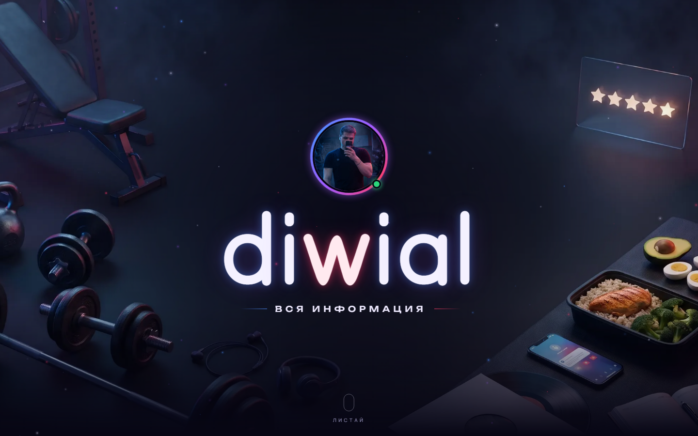

# diwial — personal site for a fitness blogger

One page with everything about a fitness blogger: social networks, personal training, advertising
prices and reviews. Reviews are collected and moderated through a Telegram bot.

**Live:** https://kyrylo157.github.io/diwial/

  
  &nbsp;
  

## Prices and reviews

  
  &nbsp;
  

## What it does

- Neon hero with animated particles and a photo gallery: gym, food, boxing, social networks
- Prices page for training and advertising
- Reviews page: a visitor leaves a review in the Telegram bot, the owner approves or rejects it
- The owner can also add a review by hand, step by step, right in the bot
- Requests for training and advertising are forwarded to the owner in Telegram
- Tuned for weak phones: the animation load was cut by more than half

## Stack

HTML, CSS, JavaScript, GitHub Pages, Cloudflare Workers, Cloudflare KV, Telegram Bot API

> This repository holds only the compiled build that GitHub Pages serves. Source code is private. Want a site like this for your business? Message me.
